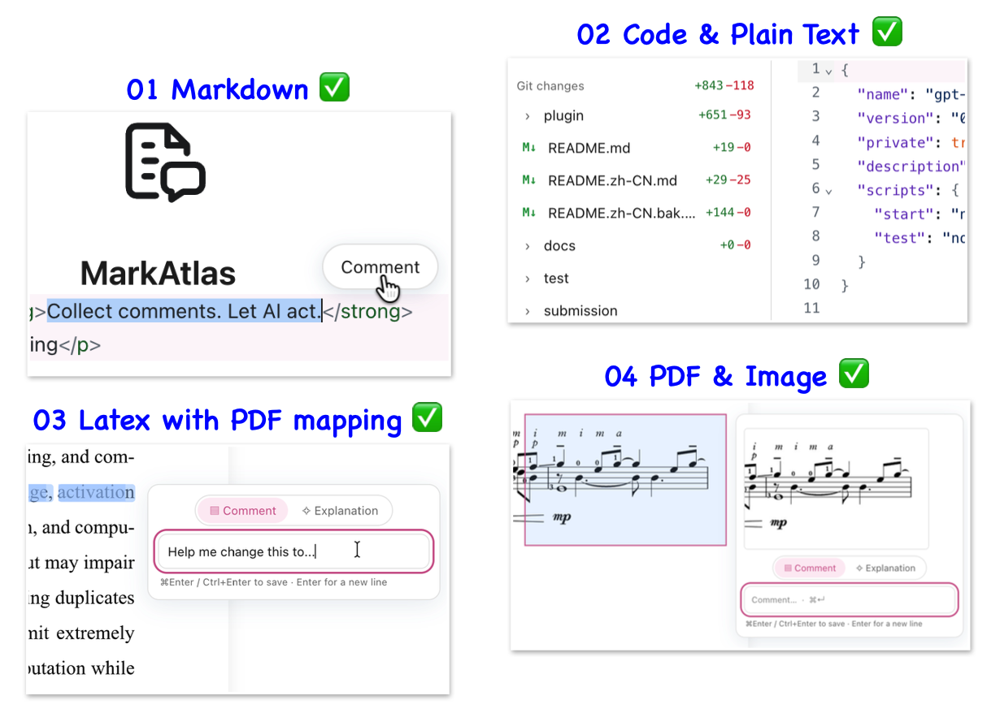
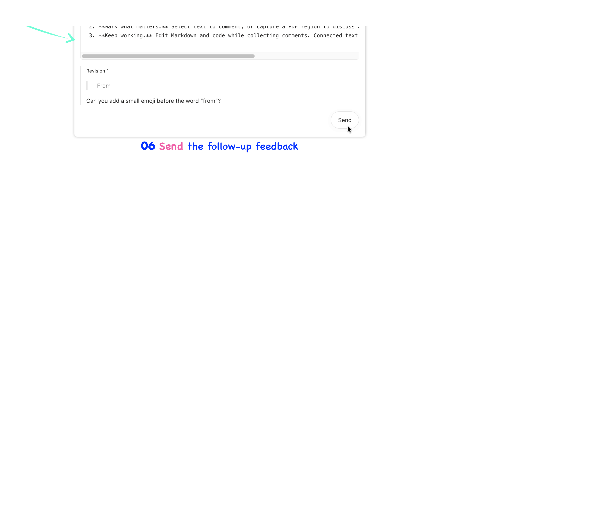

<p align="center">
  
</p>

<h1 align="center">MarkAtlas</h1>
<p align="center"><strong>收集批注，让 AI 行动。</strong><br>开发者：Zihao Jing</p>

<p align="center"><a href="README.md">English</a> | <strong>简体中文</strong></p>

MarkAtlas 将文件审阅中的批注整理成清晰的 AI 请求。阅读文档，选中需要关注的段落，在对应位置留下批注。准备好后，点击 **Send（发送）**：系统会提交一条简短请求，并将每条批注分别作为上下文附件发送，包含文件位置、精简摘录和截图。

先完整审阅，再让 AI 动手。

## 从阅读到行动

1. **打开文件或项目。** 选择本地文件后，会连接其所在文件夹并定位到该文件；也可以直接连接项目文件夹。
2. **标记重点。** 选中文字添加批注，或截取 PDF 区域，讨论图表、表格和版式。
3. **继续工作。** 收集批注的同时可以编辑 Markdown 和代码。已连接的文本文件会自动保存，批注位置也会随编辑更新。
4. **检查并发送。** 预览待发送内容，删除单条批注或全部取消，再点击 **Send（发送）**，立即提交请求和独立的上下文附件。

审阅栏会显示待发送的文件数和批注数。每份上下文都包含对应文件的位置；编号将截图与批注一一对应。已发送或删除的批注不会在查看器中留下高亮。


## 在同一工作区处理不同文件

<p align="center"></p>

> MarkAtlas 支持 Markdown、代码、纯文本、LaTeX、PDF 和图片。


| 格式 | 支持的操作 |
| --- | --- |
| **Markdown** | 阅读和编辑渲染内容或源码，支持表格，两种视图均可添加批注。 |
| **代码与纯文本** | 编辑文本，为支持的语言提供语法高亮，自动保存已连接的文件，并对选中内容添加批注。 |
| **PDF** | 连续阅读页面、围绕鼠标位置缩放、选取已有文本，并对截图区域添加批注。查看 PDF 不需要源文档。 |
| **LaTeX 项目** | 优先通过 SyncTeX 将 PDF 选区映射到 `.tex` 位置，不可用时尝试文本匹配。可让 AI 编辑源码，再用你已安装的工具链重新编译。 |
| **图片** | 在项目中预览图片。 |

从项目树打开 Office 文件时，会使用宿主应用的原生查看器。对于支持的文档输入，MarkAtlas 也提供只读 DOCX 预览。


## 先理解，再修改

选中内容后，选择 **Explanation（解释）** 和详细程度，还可以选择输入提示词说明想了解什么。AI 解释会直接显示在选区面板中，无需另开聊天标签页。如果宿主支持 MCP sampling，就使用宿主的模型调用能力；否则，通过 Codex CLI 在后台新建临时会话。请求会包含完整选区和附带截图，为解释提供必要上下文。

<p align="center"></p>

> 选中文字，写下希望修改的内容，或直接在文档中询问解释。

## 批注跟随编辑更新

发送前，批注会随文本编辑调整位置。删除已批注的段落，会同时删除对应批注；绑定旧版 PDF 的截图批注也会被移除。发送时，系统会先完成待处理的自动保存，再检查剩余文件引用。如果文件被外部程序修改，请刷新后再发送审阅内容。

最终请求使用当前文件位置，并保留你已有的编辑。发送后文件仍可能变化，因此助手会被要求在修改前核对引用的段落。

<p align="center"></p>

> 左：打开并筛选当前文件的批注和解释。右：从批注跳转到文档中的对应位置。

<p align="center"></p>

> 流程：对选中内容添加批注，发送审阅请求，再点击底部悬浮卡片打开聊天会话。

## 先审阅，再修改

MarkAtlas 支持**仅生成补丁**模式。发送前打开 **Patches（补丁）** 开关，AI 智能体只会生成补丁，不会改动原文件。你可以预览建议的补丁，直接在补丁视图中要求修改，并在满意后再应用。审阅建议修改期间，原文件始终保持不变。

<p align="center"></p>

> 开启“仅生成补丁”后发送审阅请求；可以随时对建议的修改追加批注，要求修改并收到更新后的方案。


<p align="center"></p>

> 刷新补丁以查看最新版本；修改满意后，接受并应用当前补丁；回到原文件查看更新后的版本。

## 文件访问与 AI 上下文

文件树先列出名称，打开文件时才读取内容。连接文件夹不会上传整个目录。打开本地文件也会连接其所在文件夹。宿主提供的原始路径会被保留；没有本地路径的附件使用隔离的工作副本。批注草稿保留在本地，直到你发送到聊天或请求解释。这些操作会将相关批注、选中文字或摘录，以及截图共享给宿主的 AI 服务。

编辑 Markdown 和代码会写入已连接的项目文件。普通 PDF 审阅不支持直接修改 PDF 内容。LaTeX 编译由你或助手调用你已安装的工具链完成；MarkAtlas 不附带编译器，也没有 Build（构建）按钮。

## 从源码安装到 ChatGPT 桌面版

**MarkAtlas 已提交 OpenAI 审核，目前尚不支持通过公共插件搜索安装。如果审核通过并正式发布，你将可以直接在公共插件目录中搜索并安装 MarkAtlas。现阶段请从本仓库安装。**

以下源码安装流程适用于 **macOS**，需要支持本地插件、MCP Apps 和本地聊天的 ChatGPT 桌面版。原生文件与文件夹选择器依赖 macOS 和 Apple 的 Swift 命令行工具；目前不支持 Windows 和 Linux 安装。请先安装并登录 [ChatGPT 桌面版](https://learn.chatgpt.com/docs/quickstart?setup=app)。

### 1. 下载仓库

在 GitHub 上选择 **Code → Download ZIP**，解压后在该文件夹中打开终端。如果已安装 Git，也可以执行：

```sh
git clone https://github.com/zihao-jing/gpt-commenter.git
cd gpt-commenter
```

请保留完整仓库，包括隐藏的 `.agents` 文件夹。

### 2. 运行安装脚本

在仓库根目录执行：

```sh
bash install-macos.command
```

[安装脚本](install-macos.command)会检查 Apple 命令行工具，在需要时安装 [Homebrew](https://brew.sh/)，安装 **Node.js 22 和 npm**，以及 **Poppler**（`pdftotext`、`pdftocairo` 和 `pdftoppm`），然后按锁定版本安装 npm 依赖，构建查看器、MCP 服务和原生文件选择器。PDF 查看器已包含在 MarkAtlas 中，无需另装 PDF 阅读器。请使用普通用户运行，不要加 `sudo`；Homebrew 可能会要求输入密码。如果出现 Apple 工具安装对话框，请先完成安装，再重新运行脚本。

如果宿主不支持 MCP sampling，而你希望使用后台解释功能，可以同时安装 Codex CLI：

```sh
bash install-macos.command --with-codex
```

完成后，在终端运行 `codex` 并登录。详见 [Codex CLI 指南](https://learn.chatgpt.com/docs/codex/cli)。LaTeX 编译和精确的 SyncTeX 映射还需要你自行安装 LaTeX 工具链；普通 PDF 审阅不需要这些工具。安装脚本不会安装 TeX 发行版。

### 3. 在 ChatGPT 桌面版中完成安装

脚本会在 ChatGPT 桌面版中打开 MarkAtlas 的**本地插件页面**，并在终端输出同一个链接。选择 **Install（安装）**，确认所需的访问权限。如有必要，重启 ChatGPT 桌面版，再打开终端输出的链接。如果只想构建并输出链接、不自动打开应用，请运行 `bash install-macos.command --no-open`。

打开一个在本地运行的聊天，输入 **“打开 MarkAtlas，让我审阅文件。”** 连接项目文件夹或打开文件，即可开始审阅 Markdown、代码或 PDF。扫描版 PDF 可以显示，但文字选择需要 PDF 已包含文本层。

该流程使用仓库中的[本地插件目录文件](.agents/plugins/marketplace.json)，其中的插件路径指向 `./plugin`。本地 marketplace 是插件文件夹的目录清单，不是公开上架页面，也不是托管下载服务。你可以将本仓库链接分享给其他用户：每个人下载自己的副本，运行安装脚本，再通过本地插件页面安装，无需访问你的电脑。参见 OpenAI 的[本地插件打包指南](https://developers.openai.com/plugins/build/plugins)和[本地插件链接说明](https://learn.chatgpt.com/docs/reference/commands#local-plugin)。

### 手动安装与更新

如果已经安装 Homebrew 和 Apple 的 Swift 命令行工具，可手动执行以下构建步骤：

```sh
brew install node@22 poppler
export PATH="$(brew --prefix node@22)/bin:$(brew --prefix)/bin:$PATH"
npm ci --include=dev --prefix plugin
npm run build --prefix plugin
```

之后运行 `bash install-macos.command` 打开本地安装页面。仅完成构建并不等于已安装到 ChatGPT 桌面版。如果应用无法识别链接，请更新到支持本地插件的版本；受组织管理的工作区也可能限制本地插件。

更新 Git 克隆的仓库时，运行 `git pull`，再重新运行安装脚本。在 ChatGPT 桌面版中刷新或重新安装本地插件，并重启应用以加载新构建的文件。ChatGPT 安装的是缓存副本，因此仅修改仓库中的文件不一定会更新正在运行的插件。

操作说明、故障排查和本地开发请参阅[插件指南](plugin/README.zh-CN.md)。

---

**MarkAtlas** · 开发者：**Zihao Jing**<br>
收集批注，让 AI 行动。

## 第三方组件与致谢

部分样式来源于或改编自 Blue Topaz（https://github.com/PKM-er/Blue-Topaz_Obsidian-css），特此感谢 WhyI（https://github.com/whyt-byte）和 pkmer.cn（https://pkmer.cn）。

该主题采用 MIT 许可证；版权声明及完整许可文本已保留在 [blue-topaz.css](plugin/assets/obsidian/blue-topaz.css) 中。

## 支持与政策

[支持（英文）](docs/SUPPORT.md) · [隐私政策（英文）](docs/PRIVACY.md) · [使用条款（英文）](docs/TERMS.md)

独立的 Apple Silicon 桌面分发包附带 Node 和 PDF 工具。上述源码安装流程则从本仓库构建，并使用本地安装的 PDF 工具。
